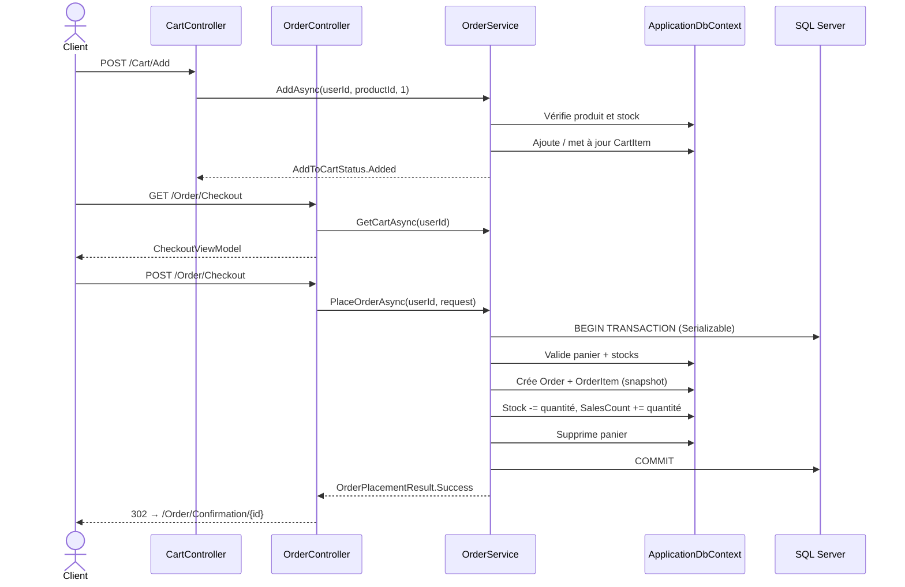
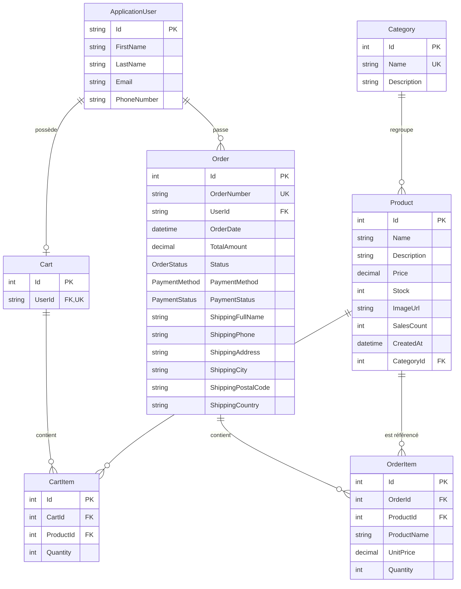

# TechZone — Boutique e-commerce ASP.NET Core MVC

> **La technologie, bien choisie.**  
> Une boutique en ligne complète (catalogue, panier, commandes, compte client) construite avec ASP.NET Core MVC, Entity Framework Core et SQL Server, autour d'une identité visuelle éditoriale et premium.

[](https://dotnet.microsoft.com/)
[](https://learn.microsoft.com/aspnet/core/mvc/overview)
[](https://learn.microsoft.com/ef/core/)
[](https://learn.microsoft.com/sql/database-engine/configure-windows/sql-server-express-localdb)
[](https://developer.mozilla.org/docs/Web/HTML)
[](https://developer.mozilla.org/docs/Web/CSS)
[](https://developer.mozilla.org/docs/Web/JavaScript)
[](https://github.com/Omar-khecharem/TechZone-AspDotNes)

---

## Sommaire

- [Aperçu](#-aperçu)
- [Fonctionnalités](#-fonctionnalités)
- [Stack technique](#-stack-technique)
- [Architecture](#-architecture)
- [Structure du dépôt](#-structure-du-dépôt)
- [Modèle de données](#-modèle-de-données)
- [Design System](#-design-system)
- [Pages et routes](#-pages-et-routes)
- [Sécurité et règles métier](#-sécurité-et-règles-métier)
- [Démarrage rapide](#-démarrage-rapide)
- [Base de données et migrations](#-base-de-données-et-migrations)
- [Données de démonstration](#-données-de-démonstration)
- [Front-end et interactions](#-front-end-et-interactions)
- [Conventions de développement](#-conventions-de-développement)
- [Limites connues et feuille de route](#-limites-connues-et-feuille-de-route)
- [Auteur](#-auteur)
- [Licence](#-licence)

---

## Aperçu

**TechZone** est une application web e-commerce pédagogique et fonctionnelle, développée en **C# / ASP.NET Core MVC** sur **.NET 10**. Elle couvre l'intégralité du parcours d'achat :

1. Exploration du catalogue avec recherche, filtres, tri et pagination.
2. Consultation d'une fiche produit détaillée.
3. Création de compte et connexion sécurisées (ASP.NET Core Identity).
4. Ajout au panier, modification des quantités et suppression d'articles.
5. Validation de commande avec adresse de livraison et paiement à la livraison.
6. Suivi de l'historique et du détail des commandes depuis l'espace client.

L'interface est **entièrement en français**, responsive et pensée selon une direction artistique « éditoriale premium » : typographie serif pour les titres, sans-serif pour l'interface, palette bleu nuit / bleu électrique, illustrations SVG maison et micro-interactions accessibles.

---

## Fonctionnalités

### Catalogue
- Recherche par nom de produit.
- Filtrage par catégorie avec compteur de produits.
- Filtrage par plage de prix (double curseur) et disponibilité.
- Tri : en vedette, prix croissant/décroissant, nom A–Z, nouveautés.
- Pagination conservant tous les filtres actifs.
- Bascule grille / liste mémorisée dans `localStorage`.
- Favoris côté client (sans compte serveur).
- **Comparateur de produits** jusqu'à 3 articles, mémorisé côté client, avec fenêtre modale native `<dialog>`.

### Compte client
- Inscription avec prénom, nom, e-mail unique et mot de passe robuste.
- Connexion / déconnexion.
- Profil modifiable (prénom, nom, téléphone) ; l'e-mail reste en lecture seule.
- Résumé des commandes récentes sur le profil.
- Messages d'erreur Identity traduits en français.

### Panier
- Panier persistant en base, lié à l'utilisateur (relation 1–1).
- Ajout, mise à jour de quantité, suppression.
- Vérification du stock en temps réel.
- Calcul du sous-total et du total côté ViewModel.
- Redirection vers la page d'origine après ajout (`returnUrl` local uniquement).

### Commandes
- Validation du panier et création de la commande dans une **transaction sérialisable**.
- Contrôle de stock avant validation.
- Décrémentation du stock et incrémentation du compteur de ventes.
- Vidage automatique du panier après commande.
- Numéro de commande lisible : `TZ-AAAAMMJJ-00001`.
- Historique paginé, détail de commande et page de confirmation.
- Statuts de commande et de paiement affichés avec badges colorés.

---

## Stack technique

| Domaine | Technologie | Version / détail |
|---|---|---|
| Runtime | .NET | `net10.0` |
| Framework web | ASP.NET Core MVC | Controllers + Razor Views |
| ORM | Entity Framework Core | `10.0.15` |
| Base de données | SQL Server / LocalDB | `TechZoneDb` |
| Authentification | ASP.NET Core Identity | Utilisateur personnalisé `ApplicationUser` |
| Validation | DataAnnotations + jQuery Validation Unobtrusive | Côté serveur et client |
| Front-end | HTML5, CSS3, JavaScript vanilla | Aucun build front-end, aucune dépendance npm |
| Icônes | SVG inline | Dessinées à la main, sans bibliothèque externe |
| Persistance navigateur | `localStorage` | Comparateur, favoris, préférence d'affichage |

### Packages NuGet

```xml
<PackageReference Include="Microsoft.AspNetCore.Identity.EntityFrameworkCore" Version="10.0.15" />
<PackageReference Include="Microsoft.EntityFrameworkCore.Design" Version="10.0.15" />
<PackageReference Include="Microsoft.EntityFrameworkCore.SqlServer" Version="10.0.15" />
<PackageReference Include="System.Security.Cryptography.Pkcs" Version="10.0.15" />
```

---

## Architecture

L'application suit une architecture **MVC en couches**, avec une séparation claire entre présentation, logique métier et accès aux données.

```text
┌─────────────────────────────────────────────────────────────┐
│                        Navigateur                           │
└───────────────────────────┬─────────────────────────────────┘
                            │ HTTP
┌───────────────────────────▼─────────────────────────────────┐
│  Présentation                                               │
│  Razor Views • ViewModels • ViewComponents • wwwroot        │
└───────────────────────────┬─────────────────────────────────┘
                            │
┌───────────────────────────▼─────────────────────────────────┐
│  Contrôleurs                                                │
│  Home • Product • Account • Cart • Order                    │
└───────────────────────────┬─────────────────────────────────┘
                            │ Interfaces
┌───────────────────────────▼─────────────────────────────────┐
│  Services métier                                            │
│  IProductService • ICartService • IOrderService             │
│  IAccountService • FrenchIdentityErrorDescriber             │
└───────────────────────────┬─────────────────────────────────┘
                            │ EF Core
┌───────────────────────────▼─────────────────────────────────┐
│  Données                                                    │
│  ApplicationDbContext • Migrations • DbSeeder               │
└───────────────────────────┬─────────────────────────────────┘
                            │
┌───────────────────────────▼─────────────────────────────────┐
│  SQL Server / LocalDB — base TechZoneDb                     │
└─────────────────────────────────────────────────────────────┘
```

### Rôle des couches

| Couche | Dossier | Responsabilité |
|---|---|---|
| Modèles de domaine | `Models/` | Entités EF Core, énumérations, résultats métier, pagination |
| Accès aux données | `Data/` | `DbContext`, configuration Fluent API, migrations, seed |
| Contrats métier | `Interfaces/` | Abstraction des services injectés |
| Services | `Services/` | Règles métier, requêtes EF Core, transactions, Identity |
| Présentation | `Controllers/` | Orchestration HTTP, validation, redirections, messages flash |
| ViewModels | `ViewModels/` | Modèles d'affichage, mapping depuis les entités, libellés |
| Vues | `Views/` | Razor, partials, layouts, composants |
| Composants | `ViewComponents/` | Navigation par catégories réutilisable |
| Assets | `wwwroot/` | CSS, JavaScript, images SVG, bibliothèques clientes |

### Flux d'une requête

1. Le navigateur appelle une route MVC.
2. Le contrôleur valide les entrées et récupère l'utilisateur courant via `ClaimTypes.NameIdentifier`.
3. Le contrôleur appelle un service métier via son interface.
4. Le service interroge `ApplicationDbContext` avec EF Core (`AsNoTracking` en lecture).
5. Les entités sont projetées en ViewModels.
6. La vue Razor est rendue avec le layout `_Layout.cshtml`.
7. Les messages de succès/erreur transitent par `TempData` puis sont affichés.

### Flux d'une commande



### Conventions d'architecture

- **Contrôleurs fins** : aucune requête EF Core directement dans les contrôleurs.
- **Interfaces systématiques** pour les services, injectées via DI dans `Program.cs`.
- **ViewModels dédiés** : les entités ne sont jamais exposées directement à la vue.
- **Mapping centralisé** : factories statiques (`FromCart`, `FromOrder`) et `OrderLabels`.
- **AsNoTracking** sur toutes les lectures pour limiter le coût de suivi EF Core.
- **Clés étrangères explicites** et comportements de suppression définis dans `OnModelCreating`.
- **Composant de navigation** mis en cache par requête via `HttpContext.Items`.

---

## Structure du dépôt

```text
TechZone-AspDotNes/
│
├── Controllers/                 # Points d'entrée HTTP
│   ├── AccountController.cs     # Inscription, connexion, profil
│   ├── CartController.cs        # Panier
│   ├── HomeController.cs        # Accueil, confidentialité, erreur
│   ├── OrderController.cs       # Checkout, historique, détail, confirmation
│   └── ProductController.cs     # Catalogue et fiche produit
│
├── Data/
│   ├── ApplicationDbContext.cs  # DbContext + Fluent API
│   ├── DbSeeder.cs              # Jeu de données initial
│   └── Migrations/              # Migrations EF Core
│
├── Interfaces/                  # Contrats des services
│   ├── IAccountService.cs
│   ├── ICartService.cs
│   ├── IOrderService.cs
│   └── IProductService.cs
│
├── Models/                      # Entités et objets métier
│   ├── ApplicationUser.cs
│   ├── Category.cs
│   ├── Product.cs
│   ├── Cart.cs
│   ├── CartItem.cs
│   ├── Order.cs
│   ├── OrderItem.cs
│   ├── PagedResult.cs
│   └── *.cs                     # Enums et objets de résultat
│
├── Services/                    # Implémentations métier
│   ├── AccountService.cs
│   ├── CartService.cs
│   ├── FrenchIdentityErrorDescriber.cs
│   ├── OrderService.cs
│   └── ProductService.cs
│
├── ViewComponents/
│   └── CategoryNavViewComponent.cs
│
├── ViewModels/                  # Modèles d'affichage
│   ├── CartViewModel.cs
│   ├── CatalogViewModel.cs
│   ├── CheckoutViewModel.cs
│   ├── HomeViewModel.cs
│   ├── Order*.cs
│   ├── Product*.cs
│   ├── ProfileViewModel.cs
│   └── ...
│
├── Views/
│   ├── _ViewImports.cshtml
│   ├── _ViewStart.cshtml
│   ├── Account/                 # Login, Register, Profile
│   ├── Cart/                    # Index
│   ├── Home/                    # Index, Privacy
│   ├── Order/                   # Checkout, Confirmation, Details, History
│   ├── Product/                 # Index, Details, _ProductCard
│   └── Shared/
│       ├── _Layout.cshtml
│       ├── _ProductArtwork.cshtml
│       ├── _ValidationScriptsPartial.cshtml
│       ├── Error.cshtml
│       └── Components/CategoryNav/Default.cshtml
│
├── wwwroot/
│   ├── css/site.css             # Design System complet (~115 Ko)
│   ├── js/site.js               # Interactions (~30 Ko)
│   ├── images/
│   │   ├── placeholder-tech.svg
│   │   └── products/*.svg       # Visuels produits
│   ├── lib/                     # jQuery, validation, unobtrusive
│   └── favicon.ico
│
├── Properties/
│   └── launchSettings.json      # Profils http / https
│
├── appsettings.json             # Chaîne de connexion
├── appsettings.Development.json
├── Program.cs                   # Configuration DI, Identity, pipeline
├── TechZone.csproj              # Cible net10.0 + packages
├── TechZone-AspDotNes.sln
├── Projet ASP.NET CORE FIGL2.pdf
└── README.md
```

---

## Modèle de données

### Diagramme entité-relation



### Entités

| Entité | Rôle | Points clés |
|---|---|---|
| `ApplicationUser` | Utilisateur Identity étendu | `FirstName`, `LastName`, `Cart` (1–1), `Orders` (1–N) |
| `Category` | Univers produit | Nom unique, description optionnelle |
| `Product` | Article du catalogue | Prix, stock, ventes, visuel, date de création |
| `Cart` | Panier d'un utilisateur | Relation 1–1 avec `ApplicationUser` |
| `CartItem` | Ligne de panier | Unique par couple `(CartId, ProductId)`, quantité > 0 |
| `Order` | Commande validée | Snapshot de l'adresse, total, statuts, numéro unique |
| `OrderItem` | Ligne de commande | **Snapshot** du nom et du prix unitaire au moment de l'achat |

### Énumérations

| Énumération | Valeurs | Libellés FR |
|---|---|---|
| `OrderStatus` | `Confirmed`, `Shipped`, `Delivered`, `Cancelled` | Confirmée, Expédiée, Livrée, Annulée |
| `PaymentMethod` | `CashOnDelivery` | Paiement à la livraison |
| `PaymentStatus` | `Pending`, `Paid`, `Failed` | En attente, Payé, Échoué |
| `AddToCartStatus` | `Added`, `ProductNotFound`, `OutOfStock`, `InsufficientStock` | Résultat d'ajout au panier |
| `CartOperationStatus` | `Success`, `ItemNotFound`, `InvalidQuantity`, `InsufficientStock` | Résultat d'opération panier |

Les énumérations de commande sont **stockées en chaînes** en base (`HasConversion<string>()`), ce qui facilite la lisibilité et la maintenance.

### Contraintes et invariants

- `Category.Name` : index unique.
- `Cart.UserId` : index unique (un panier par utilisateur).
- `CartItem (CartId, ProductId)` : index unique (pas de doublon de produit).
- `Order.OrderNumber` : index unique.
- `Product.Price`, `Product.Stock`, `Product.SalesCount` : `>= 0`.
- `CartItem.Quantity` : `> 0`.
- `Order.TotalAmount` : `>= 0`.
- `OrderItem.UnitPrice` : `>= 0`, `OrderItem.Quantity` : `> 0`.
- Montants décimaux : `decimal(18,2)`.
- Suppressions :
  - `Category → Product` : `Restrict` (une catégorie utilisée ne peut pas être supprimée).
  - `Cart → CartItem` : `Cascade`.
  - `CartItem → Product` : `Restrict`.
  - `Order → OrderItem` : `Cascade`.
  - `Order → User` : `Restrict`.
  - `OrderItem → Product` : `Restrict`.

### Numérotation des commandes

```text
TZ-20261121-00001
│  │        │
│  │        └── Identifiant de commande sur 5 chiffres
│  └─────────── Date UTC de la commande (yyyyMMdd)
└────────────── Préfixe TechZone
```

Un numéro temporaire basé sur un GUID est d'abord généré pour satisfaire la contrainte `NOT NULL`, puis remplacé par le numéro définitif après insertion et obtention de l'`Id`.

### Identité et sécurité des comptes

- `RequireUniqueEmail = true`.
- Mot de passe : 8 caractères minimum, au moins une majuscule, une minuscule et un chiffre.
- Caractère spécial non obligatoire (`RequireNonAlphanumeric = false`).
- Verrouillage activé à la connexion (`lockoutOnFailure: true`).
- Messages Identity traduits par `FrenchIdentityErrorDescriber`.

---

## Design System

Le design system est centralisé dans `wwwroot/css/site.css` et documenté par blocs. Il vise une ambiance **éditoriale, premium et technologique** : blanc lumineux, bleu nuit, bleu électrique, typographie serif contrastée et illustrations SVG dessinées à la main.

### Philosophie visuelle

- **Éditorial** : grands titres serif, respirations généreuses, hiérarchie claire.
- **Premium** : palette sobre, ombres douces, bordures fines, aucune surcharge.
- **Technologique** : bleu électrique, micro-interactions, icônes SVG au trait.
- **Accessible** : contrastes, focus visibles, navigation clavier, `prefers-reduced-motion`.
- **Responsive** : mise en page fluide de 320 px à grand écran.

### Typographie

Le site utilise deux piles de polices système, sans chargement de webfont externe.

| Usage | Variable CSS | Pile de polices |
|---|---|---|
| Titres / éditorial | `--tz-serif` | `"Iowan Old Style", "Palatino Linotype", "Georgia", "Times New Roman", serif` |
| Interface / corps | `--tz-sans` | `"Inter", "Segoe UI", system-ui, -apple-system, Arial, sans-serif` |

> **Note expert :** `Inter` est utilisée si elle est installée sur la machine, sinon le navigateur bascule sur `Segoe UI` (Windows) ou `system-ui`. Aucun `@font-face` ni import Google Fonts n'est présent, ce qui garantit zéro requête externe et un chargement immédiat.

Caractéristiques :
- Taille de base : `16px`.
- Interligne : `1.6`.
- Lissage : `-webkit-font-smoothing: antialiased`.
- Titres : serif, souvent en `em` pour les accents éditoriaux.
- Petites capitales / labels : sans-serif, `letter-spacing` léger, poids 600.

### Palette de couleurs

| Token | Hex | Usage |
|---|---|---|
| `--tz-ink` | `#111827` | Texte principal, barre d'annonce, boutons sombres |
| `--tz-ink-soft` | `#0f172a` | Variante profonde du bleu nuit |
| `--tz-paper` | `#f8fafc` | Fond secondaire très clair |
| `--tz-paper-2` | `#f1f5f9` | Fond de surface alternatif |
| `--tz-surface` | `#ffffff` | Cartes, en-têtes, surfaces principales |
| `--tz-line` | `#e5e7eb` | Bordures et séparateurs |
| `--tz-line-strong` | `#d1d5db` | Bordures accentuées |
| `--tz-muted` | `#64748b` | Texte secondaire, métadonnées |
| `--tz-accent` | `#2563eb` | Bleu électrique : liens, focus, accents |
| `--tz-accent-deep` | `#1d4ed8` | État hover / actif de l'accent |
| `--tz-sand` | `#dbeafe` | Fond bleu très clair, badges |
| `--tz-shadow` | `0 30px 70px -42px rgba(15,23,42,.18)` | Ombre douce des surfaces élevées |

Couleurs d'illustration utilisées dans les SVG :
- `#c02444` — accent corail/rouge pour les détails graphiques.
- `#19242d` — trait sombre des illustrations produits.
- `#dce8e7`, `#e8e3d8`, `#bd8978`, `#8bb4ac` — teintes des visuels illustrés.

Couleurs legacy encore présentes dans certaines vues secondaires (inline styles) :
`#6c7573`, `#007bff`, `#dc3545`, `#28a745`, `#ffc107`, `#dee2e9`, `#f8d7da`, `#f5c6cb`, `#f8f9fa`, `#ccc`.

### Layout, espacement et formes

| Token | Valeur | Usage |
|---|---|---|
| `--tz-container` | `1240px` | Largeur maximale du contenu |
| Largeur fluide | `min(1240px, 100% - 56px)` | Marges latérales automatiques |
| `--tz-radius` | `16px` | Rayon principal des cartes et boutons |
| Ombre | `--tz-shadow` | Élévation douce |
| Largeur minimale | `320px` | Support mobile étroit |

Principes :
- `box-sizing: border-box` global.
- `overflow-x: clip` sur le body pour éviter les débordements.
- Grilles CSS et Flexbox, pas de framework CSS.
- Sections rythmées par des paddings verticaux généreux.
- Cartes à bordure fine + ombre très diffuse.

### Points de rupture responsive

| Breakpoint | Usage |
|---|---|
| `1120px` | Ajustements de grilles larges |
| `1024px` | Réduction des colonnes |
| `980px` / `981px` | Bascule desktop ↔ mobile (menu burger en JS) |
| `900px` | Réorganisation de layouts compte / commandes |
| `760px` / `720px` | Passage en une colonne |
| `560px` / `540px` | Ajustements mobiles fins |

### Nomenclature CSS

Les classes suivent une convention par préfixe fonctionnel, proche de BEM :

| Préfixe | Domaine |
|---|---|
| `tz-` | Shell global : container, header, nav, footer, annonces |
| `home-` | Page d'accueil |
| `cat-` | Catalogue, filtres, comparateur, pagination |
| `pd-` | Fiche produit (`Product Details`) |
| `cart-` | Panier |
| `auth-` | Connexion, inscription, formulaires |
| `account-` | Profil et espace membre |
| `orders-` | Historique des commandes |
| `shop-` | En-têtes partagés des pages boutique |
| `is-*` | États : `is-active`, `is-in`, `is-out`, `is-current`, `is-disabled` |
| `data-*` | Hooks JavaScript, jamais utilisés pour le style |

### Organisation de `site.css`

Le fichier est découpé en blocs commentés :

1. Design System (tokens).
2. Announcement bar.
3. Header.
4. Main.
5. Footer.
6. Home — Hero.
7. Home — Sections.
8. Home — Categories.
9. Home — Products.
10. Home — Editorial band.
11. Home — FAQ.
12. Home — Final CTA.
13. Legacy utility classes.
14. Animations.
15. Responsive.
16. Catalogue.
17. Quick comparator.
18. Account — Login / Register.
19. Shop pages — shared header.
20. Cart.
21. Profile / account.
22. Order history.

### Iconographie et illustrations

- **Aucune bibliothèque d'icônes** : tous les pictogrammes sont des SVG inline.
- Traits généralement compris entre `1.7` et `2.2` px.
- Illustrations produits et catégories dessinées en SVG, dans `wwwroot/images/products/` et directement dans les vues.
- Visuel de secours : `wwwroot/images/placeholder-tech.svg`, appliqué automatiquement par `site.js` si une image est manquante.

### Accessibilité

- `lang="fr"` sur `<html>`.
- Lien d'évitement « Aller au contenu ».
- `aria-label`, `aria-expanded`, `aria-pressed`, `aria-current`, `aria-live` sur les éléments interactifs.
- Focus visible global : `outline: 2px solid var(--tz-accent); outline-offset: 3px`.
- Menu mobile avec piège de focus, fermeture par `Échap` et restauration du focus.
- Respect de `prefers-reduced-motion`.
- Modale de comparaison basée sur `<dialog>` natif.
- Messages de statut et d'erreur avec rôles `status` / `alert`.

### État du design

Le design system est pleinement appliqué sur :
`Home`, `Product/Index`, `Product/Details`, `Account/Login`, `Account/Register`, `Account/Profile`, `Cart/Index`, `Order/History`.

Les pages suivantes utilisent encore des styles inline historiques et constituent une cible d'harmonisation :
`Order/Checkout`, `Order/Confirmation`, `Order/Details`, `Home/Privacy`, `Shared/Error`.

---

## Pages et routes

| Méthode | Route | Contrôleur | Accès | Description |
|---|---|---|---|---|
| GET | `/` | `Home` | Public | Page d'accueil |
| GET | `/Home/Privacy` | `Home` | Public | Politique de confidentialité (placeholder) |
| GET | `/Home/Error` | `Home` | Public | Page d'erreur |
| GET | `/Product` | `Product` | Public | Catalogue (`q`, `categoryId`, `minPrice`, `maxPrice`, `inStock`, `sort`, `page`) |
| GET | `/Product/Details/{id}` | `Product` | Public | Fiche produit |
| GET | `/Account/Register` | `Account` | Public | Formulaire d'inscription |
| POST | `/Account/Register` | `Account` | Public | Création du compte + connexion automatique |
| GET | `/Account/Login` | `Account` | Public | Formulaire de connexion |
| POST | `/Account/Login` | `Account` | Public | Authentification |
| POST | `/Account/Logout` | `Account` | Authentifié | Déconnexion |
| GET | `/Account/Profile` | `Account` | Authentifié | Profil et commandes récentes |
| POST | `/Account/Profile` | `Account` | Authentifié | Mise à jour du profil |
| GET | `/Cart` | `Cart` | Authentifié | Panier |
| POST | `/Cart/Add` | `Cart` | Authentifié | Ajout d'un produit |
| POST | `/Cart/UpdateQuantity` | `Cart` | Authentifié | Modification de quantité |
| POST | `/Cart/Remove` | `Cart` | Authentifié | Suppression d'une ligne |
| GET | `/Order/Checkout` | `Order` | Authentifié | Formulaire de commande |
| POST | `/Order/Checkout` | `Order` | Authentifié | Validation de la commande |
| GET | `/Order/Confirmation/{id}` | `Order` | Authentifié | Confirmation de commande |
| GET | `/Order/History?page=n` | `Order` | Authentifié | Historique paginé |
| GET | `/Order/Details/{id}` | `Order` | Authentifié | Détail d'une commande |

Tous les `POST` sont protégés par `[ValidateAntiForgeryToken]`.

---

## Sécurité et règles métier

### Authentification et autorisation
- ASP.NET Core Identity avec `ApplicationUser`.
- `[Authorize]` sur `AccountController`, `CartController` et `OrderController`.
- `[AllowAnonymous]` sur `Register` et `Login`.
- Contrôle systématique de l'utilisateur courant via `ClaimTypes.NameIdentifier`.
- Toutes les requêtes panier/commande sont filtrées par `UserId` : un utilisateur ne peut jamais lire ou modifier les données d'un autre.

### Protection des entrées
- Validation serveur via DataAnnotations.
- Validation client via jQuery Validation Unobtrusive.
- Anti-forgery sur tous les formulaires `POST`.
- `Url.IsLocalUrl(returnUrl)` pour empêcher les redirections ouvertes.
- Liste blanche des tris autorisés (`featured`, `price-asc`, `price-desc`, `name-asc`, `newest`).
- Bornage des pages et des tailles de page (`Math.Clamp`, `Math.Max`).
- Normalisation des prix (`,` → `.`, espaces insécables supprimés).
- Troncature de la recherche à 100 caractères.
- Validation de l'existence de la catégorie demandée.

### Intégrité métier
- Transaction `Serializable` lors de la validation d'une commande.
- Vérification du stock avant création de la commande.
- Snapshot du nom et du prix dans `OrderItem` pour préserver l'historique.
- Décrémentation du stock + incrémentation des ventes dans la même transaction.
- Suppression du panier après commande réussie.
- Contraintes `CHECK` en base pour les montants, stocks et quantités.

### Transport et configuration
- `UseHttpsRedirection()` activé.
- HSTS en production.
- Chaîne de connexion LocalDB avec `Trusted_Connection` (aucun secret commité).
- En production, utiliser `dotnet user-secrets`, des variables d'environnement ou un coffre-fort de secrets.

---

## Démarrage rapide

### Prérequis

- **.NET 10 SDK** (`10.0.401` utilisé pour le développement).
- **SQL Server LocalDB** (installé avec Visual Studio ou les outils SQL Server).
- **EF Core CLI** pour appliquer les migrations :
  ```powershell
  dotnet tool install --global dotnet-ef
  ```
- Windows recommandé pour LocalDB ; sur macOS/Linux, adapter la chaîne de connexion vers SQL Server, Azure SQL ou un conteneur.

### Installation

```powershell
git clone https://github.com/Omar-khecharem/TechZone-AspDotNes.git
cd TechZone-AspDotNes

dotnet restore
dotnet ef database update
dotnet run
```

### URLs de développement

| Profil | URL |
|---|---|
| HTTP | `http://localhost:5075` |
| HTTPS | `https://localhost:7111` |

Les profils sont définis dans `Properties/launchSettings.json`.

### Chaîne de connexion

`appsettings.json` :

```json
{
  "ConnectionStrings": {
    "DefaultConnection": "Server=(localdb)\\MSSQLLocalDB;Database=TechZoneDb;Trusted_Connection=True;MultipleActiveResultSets=true;TrustServerCertificate=True"
  }
}
```

Pour utiliser une autre instance SQL Server :

```json
"DefaultConnection": "Server=MON_SERVEUR;Database=TechZoneDb;User Id=mon_user;Password=mon_mot_de_passe;TrustServerCertificate=True"
```

### Premier lancement

1. La base `TechZoneDb` est créée/mise à jour via `dotnet ef database update`.
2. Au démarrage, `DbSeeder.SeedAsync` vérifie s'il existe déjà des produits.
3. Si le catalogue est vide, il insère 4 catégories et 12 produits.
4. Créez ensuite un compte via `/Account/Register` pour tester le panier et les commandes.

> **Important :** l'application applique le seed mais **n'exécute pas automatiquement les migrations**. Lancez `dotnet ef database update` avant le premier démarrage.

### Dépannage

| Problème | Cause probable | Solution |
|---|---|---|
| `Cannot open database "TechZoneDb"` | Migrations non appliquées | `dotnet ef database update` |
| LocalDB introuvable | LocalDB non installé | Installer SQL Server Express LocalDB |
| Erreur de certificat HTTPS | Certificat de développement absent | `dotnet dev-certs https --trust` |
| Ancienne base / schéma obsolète | Migration non appliquée | `dotnet ef database update` |
| Images manquantes | Fichier SVG absent | Le fallback `placeholder-tech.svg` s'applique automatiquement |

---

## Base de données et migrations

### Migrations présentes

| Migration | Objet |
|---|---|
| `20261118100055_InitialCreate` | Création du schéma initial |
| `20261118101101_AddFirstAndLastNameToUser` | Ajout de `FirstName` et `LastName` |
| `20261118104353_AddOrderPaymentFields` | Ajout des champs de paiement |

Le snapshot courant est `Data/Migrations/ApplicationDbContextModelSnapshot.cs`.

### Commandes utiles

```powershell
# Appliquer les migrations
dotnet ef database update

# Créer une nouvelle migration
dotnet ef migrations add NomDeLaMigration

# Supprimer la dernière migration non appliquée
dotnet ef migrations remove

# Lister les migrations
dotnet ef migrations list

# Supprimer la base (attention : destructif)
dotnet ef database drop
```

### Stratégie de seed

- Le seed est **idempotent** : il ne s'exécute que si `Products` est vide.
- Les catégories sont créées ou réutilisées par nom.
- Les visuels pointent vers des SVG locaux.
- Les dates de création sont relatives à la date du seed (`DateTime.UtcNow`).

---

## Données de démonstration

### Catégories

| Catégorie | Description |
|---|---|
| Ordinateurs portables | Portables pour le travail, les études et les loisirs |
| Smartphones | Téléphones mobiles et accessoires associés |
| Accessoires | Périphériques et accessoires pour ordinateurs |
| Écrans | Moniteurs et écrans haute définition |

### Produits

| Produit | Catégorie | Prix | Stock | Ventes |
|---|---|---:|---:|---:|
| UltraBook Pro 14 | Ordinateurs portables | 1 299,99 € | 12 | 42 |
| Notebook Air 13 | Ordinateurs portables | 949,00 € | 18 | 35 |
| Studio Laptop 16 | Ordinateurs portables | 1 599,00 € | 7 | 18 |
| Pulse X5 | Smartphones | 699,99 € | 25 | 64 |
| Pulse Mini | Smartphones | 449,00 € | 30 | 27 |
| Nova Ultra | Smartphones | 899,00 € | 14 | 51 |
| Clavier mécanique K80 | Accessoires | 89,90 € | 40 | 73 |
| Souris ergonomique M20 | Accessoires | 39,90 € | 60 | 48 |
| Casque Bluetooth H7 | Accessoires | 129,00 € | 22 | 39 |
| Chargeur USB-C 65 W | Accessoires | 34,90 € | 80 | 85 |
| Écran 27 pouces QHD | Écrans | 279,00 € | 16 | 22 |
| Écran 32 pouces 4K | Écrans | 449,00 € | 10 | 30 |

Chaque produit possède un visuel SVG dans `wwwroot/images/products/`.

---

## Front-end et interactions

`wwwroot/js/site.js` est découpé en modules autonomes (IIFE), sans framework.

### Modules

| Module | Responsabilité |
|---|---|
| Fallback images | Remplace une image cassée par `placeholder-tech.svg` |
| Barre d'annonce | Rotation automatique des messages, pause au survol/focus |
| Header | Ombre à partir de 8 px de scroll |
| Menu mobile | Ouverture/fermeture, focus trap, `Échap`, restauration du focus |
| Dropdowns `<details>` | Fermeture au clic extérieur et via `Échap` |
| FAQ | Accordéon accessible avec hauteur animée |
| Filtres catalogue | Double range de prix, auto-submit, tri |
| Vue grille/liste | Mémorisation dans `localStorage` |
| Favoris | Mémorisation locale, `aria-pressed` |
| Comparateur | Sélection max. 3 produits, `localStorage`, `<dialog>` natif |
| Mots de passe | Boutons afficher/masquer |

### Bibliothèques clientes

- **jQuery** : présent dans `wwwroot/lib/jquery/`.
- **jQuery Validation + Unobtrusive** : utilisés uniquement pour la validation côté client via `_ValidationScriptsPartial.cshtml`.
- **Aucun framework CSS** : Bootstrap a été retiré ; tout le style est custom.
- **Aucun bundler** : les fichiers sont servis directement par ASP.NET Core (`MapStaticAssets`).

---

## Conventions de développement

### C#

- Namespaces alignés sur les dossiers (`TechZone.Controllers`, `TechZone.Services`, etc.).
- Nullable activé (`<Nullable>enable</Nullable>`).
- Implicit usings activés.
- Champs privés préfixés par `_`.
- Services injectés par constructeur.
- `async/await` avec suffixes `Async`.
- Résultats métier typés plutôt que `bool` / exceptions pour les cas attendus.
- Entités jamais exposées directement aux vues.

### Razor

- `_ViewImports.cshtml` importe `TechZone`, `TechZone.Models`, `TechZone.ViewModels` et les Tag Helpers.
- Layout global `_Layout.cshtml`.
- Partials réutilisables : `_ProductCard`, `_ProductArtwork`.
- ViewComponent `CategoryNav` pour la navigation par catégories.
- Sections `Scripts` optionnelles.
- Tag Helpers `asp-controller`, `asp-action`, `asp-route-*`, `asp-for`.

### CSS / JS

- CSS custom properties pour tous les tokens.
- Pas de `!important` sauf nécessité.
- JS vanilla, hooks `data-*`, aucun style piloté par JavaScript.
- Code défensif face aux APIs navigateur indisponibles.
- Respect de `prefers-reduced-motion`.

### Git

- Branche principale : `main`.
- Historique existant : commits fonctionnels en anglais (`feat: ...`, `Home new design`, `Good style`).
- Pour contribuer : créer une branche, commiter de façon atomique, ouvrir une Pull Request.

---

## Limites connues et feuille de route

### Limites actuelles

- **Aucun projet de tests automatisés** (unitaires, intégration ou E2E) dans le dépôt.
- Paiement **simulé** : seul le paiement à la livraison est disponible.
- Pas d'espace administrateur (CRUD produits/catégories/commandes).
- Pas de vérification d'e-mail, de réinitialisation de mot de passe ni de double authentification.
- Favoris et comparateur stockés uniquement côté navigateur.
- Pages `Checkout`, `Confirmation`, `Details`, `Privacy` et `Error` encore en styles inline legacy.
- Visuels produits sous forme d'illustrations SVG, pas de photos réelles.
- LocalDB est orienté Windows ; déploiement Linux/macOS à adapter.

### Pistes d'amélioration

- [ ] Ajouter des tests xUnit + intégration `WebApplicationFactory`.
- [ ] Intégrer un vrai fournisseur de paiement (Stripe, PayPal).
- [ ] Créer un back-office administrateur avec rôles Identity.
- [ ] Implémenter la vérification e-mail et la réinitialisation du mot de passe.
- [ ] Passer les favoris et le comparateur côté serveur.
- [ ] Migrer les pages legacy vers le design system.
- [ ] Ajouter la gestion de plusieurs images par produit.
- [ ] Ajouter un Docker Compose avec SQL Server pour un démarrage reproductible.
- [ ] Mettre en place une CI GitHub Actions (build + tests).
- [ ] Ajouter un journal d'audit des commandes et des changements de statut.

---

## Auteur

**Omar Khecharem**

- GitHub : [@Omar-khecharem](https://github.com/Omar-khecharem)
- Dépôt : [TechZone-AspDotNes](https://github.com/Omar-khecharem/TechZone-AspDotNes)

Projet réalisé dans un cadre pédagogique (FIGL2) et conçu comme une base solide pour une boutique e-commerce ASP.NET Core.

---

## Licence

Ce projet est publié à des fins **pédagogiques et de démonstration**. Aucune licence open source explicite n'est fournie dans le dépôt. Pour un usage commercial ou une redistribution, ajoutez une licence adaptée (MIT, Apache 2.0, etc.) et vérifiez les droits sur les visuels et contenus.

---

<p align="center">
  <strong>TechZone</strong> — La technologie, bien choisie.
</p>
